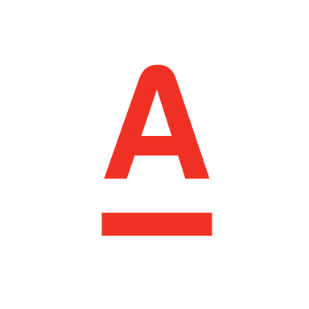
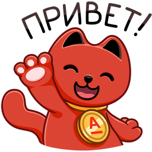
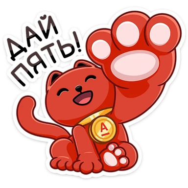
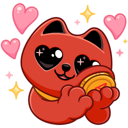
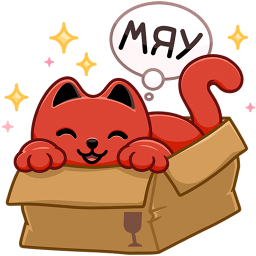
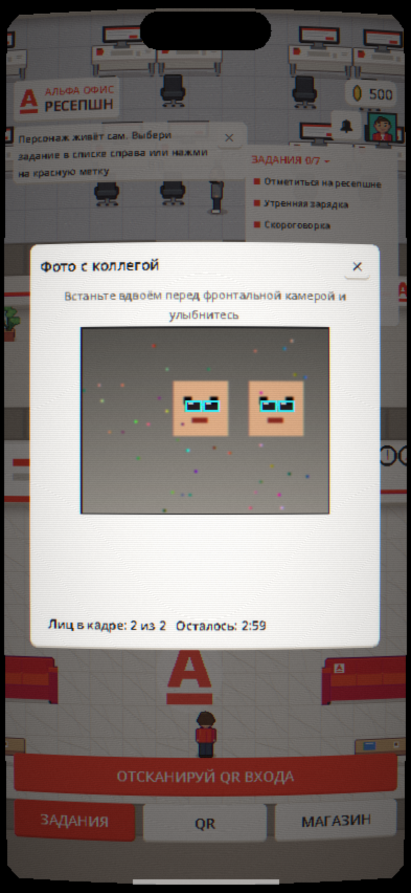
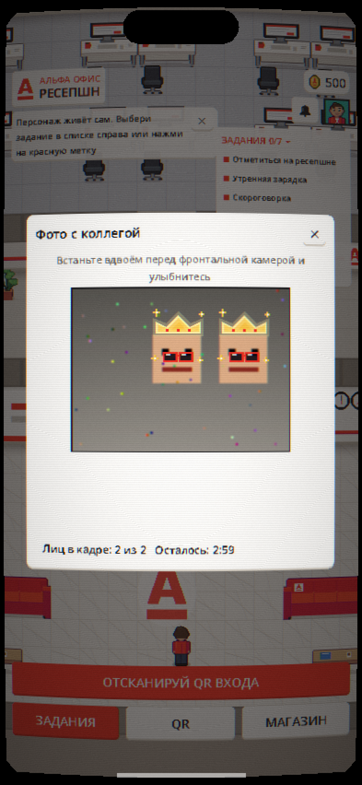
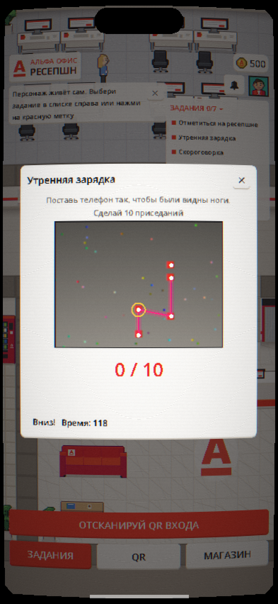

# Отчёт по выполненным задачам

Скриншоты берутся из `docs/screenshots` и `client/assets/brand/emblems`. Где подходящего скриншота ещё нет,
это отмечено «скриншот нужно снять».

## 1. Колесо фортуны

Добавили колесо фортуны: за 300 коинов в день игрок крутит колесо и получает случайный приз. На колесе 8 секторов:
два с монетами (+100 и +500) и шесть с наградами из магазина. Награды на колесе каждый рабочий день выбираются
заново из общего списка наград, по тем же правилам редкости, что и в магазине. Колесо одно на всех сотрудников.
Результат выбирает сервер, телефон только докручивает колесо до нужного сектора. Если выпала награда, которой
нет в наличии или которая у игрока уже есть, её можно обменять: бесплатный повторный спин или монеты по цене награды.
Под колесом игрок видит шанс каждого сектора.

Скриншот: нужно снять (вкладка колеса в магазине, `client/scripts/ui/wheel/`).

## 2. Айдентика Альфа-Банка вместо QR-кодов комнат

Статичные QR-коды комнат заменили картинками из айдентики банка: четыре версии логотипа и стикеры с красным
котом. Для каждой из 14 комнат своя эмблема (ресепшн, кабинет, опенспейс, переговорка, кухня, зона отдыха и т. д.).
Эмблема висит на месте бывшего QR и делает то же самое: игрок наводит камеру, игра узнаёт картинку, отмечает,
что он в этой комнате, и засчитывает задание. Распознавание идёт на телефоне, через MediaPipe Image Embedder.
Список соответствий лежит в `client/assets/brand/emblems/emblems.json`. Распечатать эмблемы можно скриптом
`tools/printables/make_printables.py`.

Скриншоты (сами эмблемы):

Скриншот камеры, которая узнаёт эмблему: нужно снять на телефоне.

## 3. Больше AR-заданий

К существующим AR-играм (примерка очков и короны на селфи, приседания с позой на камере) добавили три новые:

- «Повтори позу»: нужно повторить 4 позы золотого силуэта и удержать каждую.
- «Бумажный баскетбол»: найти в комнате AR-урну и бросить в неё бумажку свайпом, учитывая ветер.
- «Маска кота»: в маске кота Альфы выполнять команды: улыбнуться, подмигнуть, открыть рот, наклонить голову.

Скриншоты прежних AR-игр:

Скриншоты новых игр нужно снять на телефоне (камера).

## 4. Ревью текущей версии сервиса

Подробного документа-ревью в репозитории нет, раздел нужно наполнить по результатам ручной проверки.
Что известно по коду:

- Покрыто автотестами: экономика и колесо (`server/modules/economy_test.go`, `wheel_test.go`), AR-игры
  (`client/tests/unit/test_ar_games.gd`), эмблемы комнат (`test_room_emblems.gd`).
- Рядом с этим лежит `docs/economy.md` с описанием экономики и идеями на будущее («Собери кота», AR-квест
  по эмблемам, «Неоновый тир», «Командная пирамида»).

Разделы «работает исправно / требует тестирования / сломано» заполнять нужно после прогона на реальном iPhone.

## 5. Подбор наград в магазине и колесе

Проверили, как работает подбор. Подробности в `docs/economy.md`.

- Частота: сначала разыгрывается редкость с весами 58 / 28 / 11 / 3 (обычная, редкая, эпическая, легендарная),
  потом случайная награда этой редкости. Легендарная в магазине бывает примерно раз в шесть дней. Если награды
  нужной редкости закончились, берётся более частая. Раньше у колеса из-за этого мог пустеть сектор, теперь исправлено.
- Количество: `weekly_stock` в `server/content/shop_catalog.json` задаёт, сколько штук награды выдаётся в неделю.
  Админ меняет лимит и остаток во вкладке «Награды». В понедельник остаток восстанавливается до лимита.
- Награда закончилась: остаётся на витрине с пометкой «Нет в наличии», купить нельзя.
- Покупка того, что уже есть: вещи гардероба и машины покупаются один раз, остальное можно брать снова в другие дни.
- Журнал: каждое изменение баланса пишется в леджер кошелька, каждая выданная награда в `reward_log`. Админка
  показывает по каждой награде остаток, сколько выдано через магазин и колесо и сколько выигрышей обменяли.

Скриншот: вкладка «Награды» в админке нужно снять заново; `docs/screenshots/10-shop.png` показывает магазин
со старыми ценами и для отчёта не подходит.

## 6. Экономика и цены

Посчитали доходы типичного игрока (7 из 14 заданий в день, около 80% выполняется) и нашли перекос: за первую неделю
получалось 1 919 коинов, за месяц 8 529, а худи покупалось в первый день, выходной на седьмой рабочий день.
Поменяли настройки:

- приветственный бонус 500 → 300;
- дневной лимит 700 → 600;
- серия растёт на 0,05 в день, максимум ×1,5 (было 0,1 и ×2,0);
- скидки в магазине до 30% (было до 50%);
- цены: обычные награды 150–300, редкие 700–1 000, эпические 2 800–3 200, легендарные 14 000–16 000, спин колеса 300.

Теперь доход около 350–390 коинов в день: обычная награда стоит около дня работы, редкая 2–3 дня, эпическая около
двух недель, легендарная около двух месяцев. Тест `economy_test.go` падает, если новые правки ломают этот баланс.

Скриншот: нужно снять магазин с новыми ценами.
